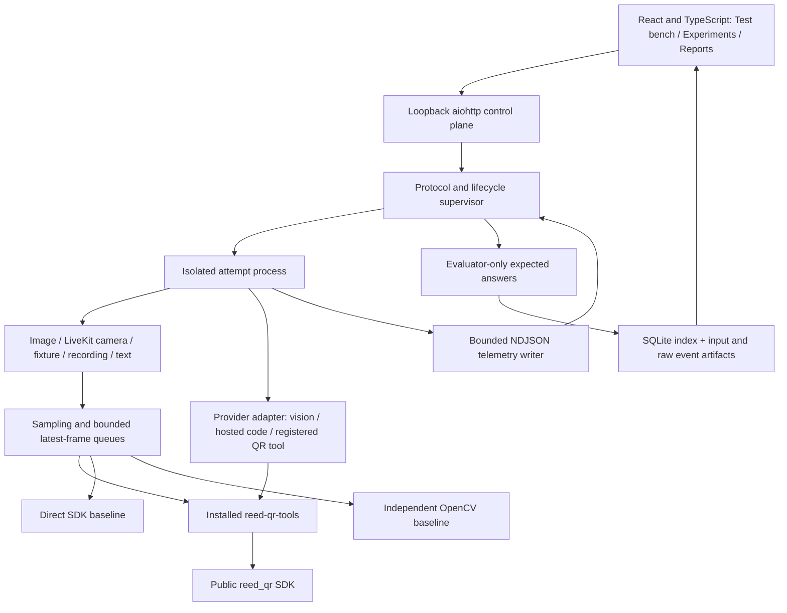

# REED QR Bench architecture

REED QR Bench is an embeddable-capability demonstration and an evaluation host.
The public SDK owns QR decoding/encoding. The host owns authorization, sources,
workload scheduling, measurements, and evaluation.

## Boundaries and ownership

| Component | Responsibility |
| --- | --- |
| `web/src` | Responsive dark application, source controls, live gauges/charts, protocols, reports and exports. LiveKit browser code loads when needed. |
| `server.py` | Loopback host/origin/CSRF checks, authorized uploads, settings, and report/artifact routes. Keys remain in host memory/environment. |
| `config.py` | Versioned, bounded protocol; explicit paid-cloud and voice requirements; targets frozen before execution. |
| `supervisor.py` | Seeded attempt ordering, process ownership, deadlines, cancellation, evaluation, progress, and component resource sampling. |
| `worker.py` | One disposable process per attempt. Warmup precedes measurement. Every processed frame, including misses and rejected late results, is counted. |
| `pipeline.py` | One active task and one pending latest frame per source; sampling; generation retirement; result age checks; bounded decoder executors. |
| `transport.py` | Owned local LiveKit process, scoped room tokens, public RTC readers/publishers, recording replay, track replacement and reconnect/pause workloads. |
| `packages/reed-qr-tools` | Installable image/frame/encoding operations and provider-neutral image tool declaration using public SDK APIs. |
| `adapters.py`, `providers.py` | Provider registry, streamed REST protocols, authorized QR function calls, hosted-code modes, observed stages and token usage. |
| `voice.py`, `voice_agent.py` | Optional owned LiveKit Cloud worker/room. The voice function calls the measured QR worker through the local host. |
| `metrics.py` | Quantiles, rolling rates, independent-attempt summaries, Wilson accuracy intervals, bootstrap median intervals, matched observer overhead. |
| `corpus.py`, `fixtures.py` | Independent Segno fixtures and labelled imported/public corpora. Expected answers stay in the evaluator. |
| `store.py`, `replay.py` | SQLite metadata; checksummed artifacts and exports; verified replay of stored input bytes. |

The SDK scanner's public event stream reports detections/faults rather than every
empty frame. Bench therefore instruments public frame operations at the host
boundary; it does not infer FPS from detection events or patch private SDK state.
The plugin and direct SDK run over the same host transport and scheduler. This is
a measurement of this embedding, not a claim about an uninstrumented internal
LiveKit SDK feature.

## Data and execution flow

The evaluator prepares labelled cases, writes exact input artifacts, then sends an
opaque input ID, bytes, mode, and workload settings to a worker. It omits expected
answers and acceptance targets from worker/model context. The model sees a fixed
decoding instruction and its authorized image; a QR tool call can resolve only
that image. Provider code tools execute in the provider environment, when supported.

Each attempt starts a new process, with separate startup, warmup, measurement, and
cleanup events. Native work is owned until completion; a deadline/stop can enforce
a hard process boundary. Frames/results carry source generations. Retiring a
track clears pending work and rejects results from its previous generation.
Per-source tasks are bounded; requested sampling Hz is a limit, not a promise.

Live telemetry is emitted about four times per second, independent of detections.
The UI keeps the latest 240 points and recent lifecycle events. Raw completion
events go to disk. Quantiles retain up to 20,000 completions per attempt, with that
scope recorded. Worker CPU/RSS are separate from host, server, and optional voice
agent samples. Browser/provider process costs are not silently included.

The optional agent does not decode from its model's vision. Its registered tool
requests a fresh eligible received-frame result from the installed QR capability.
The browser publishes camera/microphone only after the user starts a voice-enabled
test. Agent speech and QR timings retain distinct labels and clocks.

## Persistence and compatibility

Runs use schema 2 and a measurement revision plus code/package fingerprints.
SQLite indexes reports; each run owns its report, actual inputs, optional corpus
archive/recording, worker event files, and local diagnostic logs. Exported evidence
excludes private stderr logs and includes SHA-256 hashes. Historical application
data stays in its original directory and is not reinterpreted as new evidence.

The default SDK installation is the pinned PyPI distribution. Reports identify
the installed package and its fingerprint. CI also installs the tools wheel in a
clean environment and checks image/frame operations through the published SDK.
